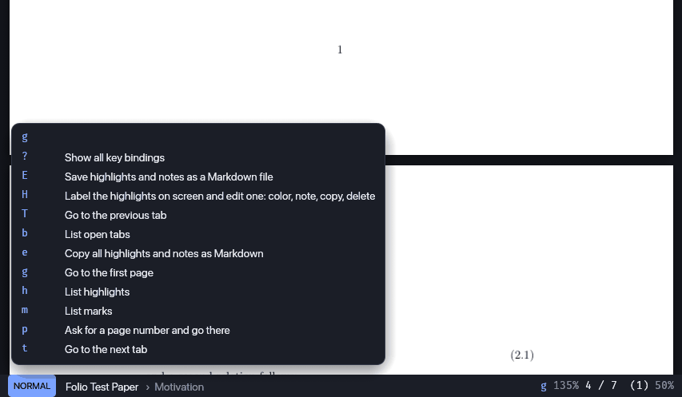
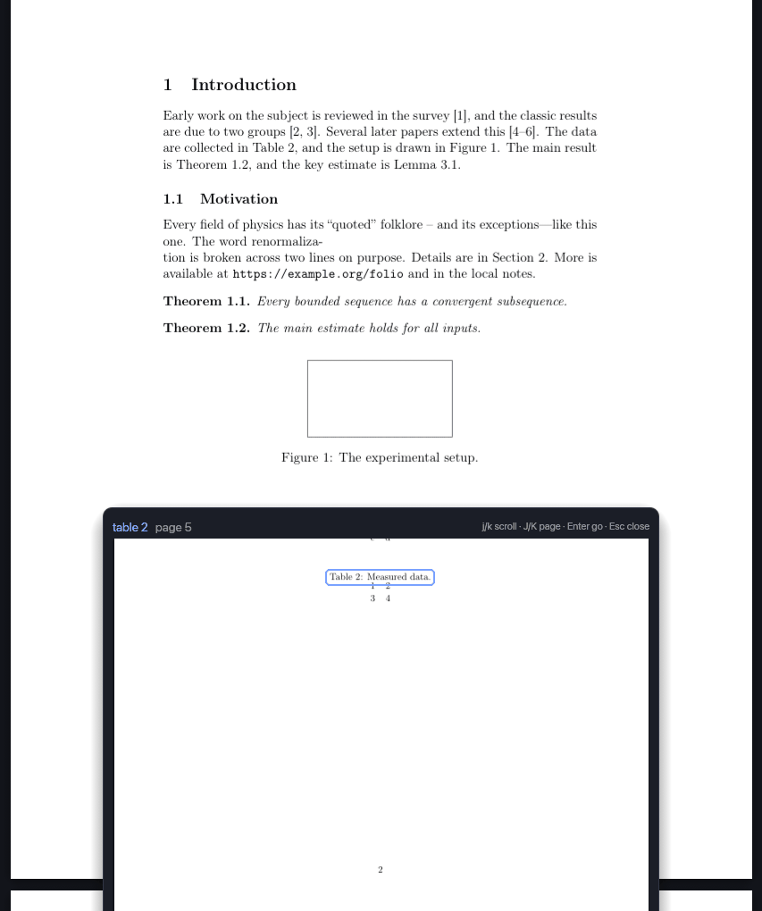
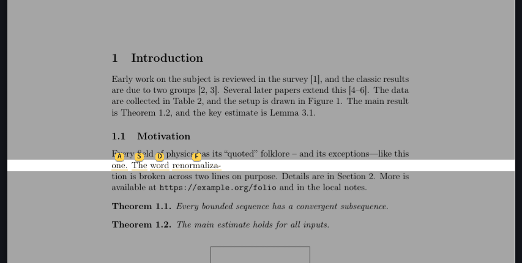
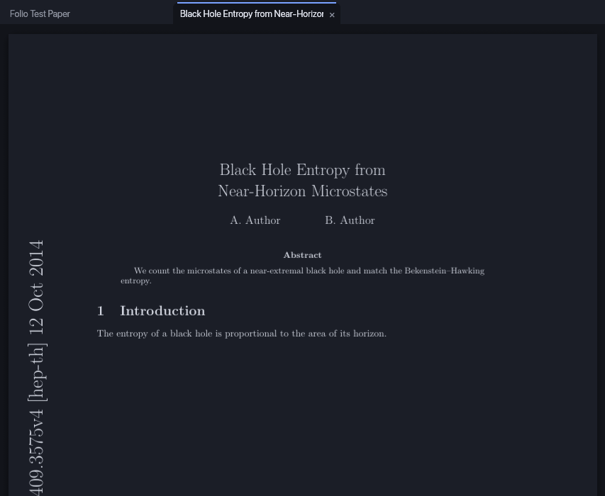

# Getting started

## Install

Download the archive for your platform from the
[latest release](https://github.com/apratimr7/folio/releases/latest):

- **macOS**: unzip and move `folio.app` to Applications. The first time, right-click it and choose *Open* (the app
  isn't notarized yet). To make folio your PDF viewer: *Get Info* on any PDF, *Open with: folio*, *Change All…*.
- **Windows**: unzip anywhere and run `folio.exe`. If SmartScreen warns about an unknown publisher, choose *More
  info*, then *Run anyway*.
- **Linux**: `tar xzf folio-*.tar.gz`, then `install -Dm755 folio-*/folio ~/.local/bin/folio`. Copy `folio.desktop`
  to `~/.local/share/applications/` and `folio.svg` to `~/.local/share/icons/hicolor/scalable/apps/` so it appears
  under *Open with*.

To build it yourself, see [Building](BUILDING.md).

## Open a document

Double-click a PDF (once folio is your viewer), run `folio paper.pdf`, or start folio and press `oo` for the system's
file dialog. `of` opens a keyboard file picker instead, and `O` lists recent documents. A PDF opened while folio is
running becomes a new tab in its window.

## Move around

| keys | |
|---|---|
| `j` `k`, `Space`, `Ctrl-d` `Ctrl-u` | scroll |
| `J` `K` | next / previous page |
| `gg` `G`, `:42` | first / last page, page 42 |
| `+` `-` `w` | zoom, fit width |
| `t` | jump to a section (table of contents) |
| `/` then `n` `N` | search, next / previous match |
| `Ctrl-o` `Ctrl-i` | jump back / forward |

Press `g` (or `o`, `z`) and wait a moment: a menu shows every key that can follow.

## Follow references

`s` labels every reference on screen. Type a label to jump there, or the same label in **uppercase** to peek at the
target in a floating window: `j`/`k` scroll it, `Enter` jumps, `Esc` closes. `f`/`F` do the same for hyperlinks.

## Select, copy, highlight

`v` labels the rows on screen; type one, then a word on it, and the selection starts there. Extend it with `w`, `j`,
`$` and friends (it can run onto the next page), then `y` copies, `H` highlights and `a` adds a note. `gh` lists your
highlights, `gH` edits one.

## Make it yours

- `i` toggles dark pages (colors in figures are kept), `T` cycles the themes.
- `ot` opens another document in a tab; `gt` and `gT` switch between tabs.
- `:` opens the command palette with every command; `F1` lists every key binding.
- `folio --init-config` writes a commented `config.toml` and `init.lua` to change keys, colors and behavior. See
  [Configuration](CONFIGURATION.md) and [Scripting with Lua](SCRIPTING.md).

