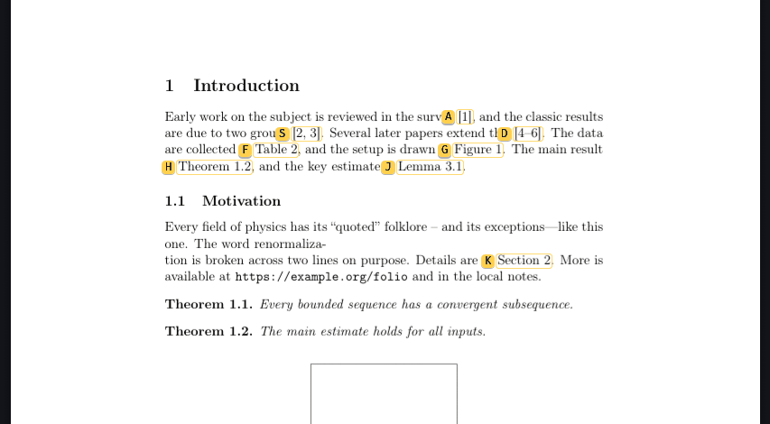

# folio

A keyboard-first PDF reader for technical documents: papers, textbooks and your own LaTeX or Typst output. It runs
on Linux, macOS and Windows as one self-contained program.

- **Smart references.** Press `s` and every `[12]`, `Fig. 3`, `Eq. (2.4)`, `Theorem 1.2` or `Sect. 3.1` on screen gets
  a label. Type it to jump to the definition, or in uppercase to **peek** at it without losing your place. This works
  even in PDFs without hyperlinks.
- **Modal, vim-style keys** with counts, marks and a jump list, all rebindable. A menu shows what can follow a prefix.
- **Tabs**, restored when folio starts; files opened from the file manager or the command line join the running
  window.
- **Keyboard selection** across pages, **highlights with notes** you can edit, bookmarks and Markdown export.
- **Reading ruler**, **hue-preserving dark pages**, four themes, every color configurable.
- **Lua scripting** and **remote control**, the base for the AI features to come.

New here? Start with [Getting started](getting-started.md). Every key and command is in [Using folio](USAGE.md) and
the [Command reference](COMMANDS.md).

folio is free software under the GNU AGPL v3.0 or later, and renders with [MuPDF](https://mupdf.com). The source is
on [GitHub](https://github.com/apratimr7/folio).
